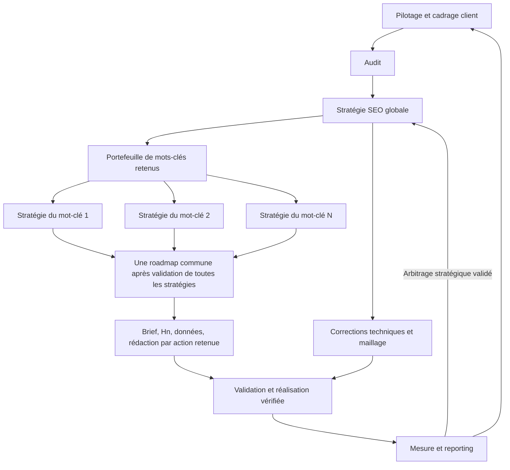

# Agents spécialisés pour le cycle d'une mission SEO

La proposition applique le framework de création d'agents au cycle client Organikk. Chaque rôle possède une mission principale, des méthodes identifiées, des livrables validés et des conditions de transmission. Le coffre du client conserve ses données et son état ; seo-kb apporte la doctrine commune. [[methodes/framework-creation-agent-specialise]] [[moc/doctrine-seo-reference]]

Cette page est une architecture proposée. Elle identifie les méthodes présentes sur le poste et les contrats à construire. Elle ne constate pas l'installation de tous les agents, de leurs contrôleurs ou de leurs programmations.

## Responsabilités

| Agent | Mission principale | Socle existant à réutiliser | Livrable de responsabilité |
|---|---|---|---|
| Pilotage et suivi client | Savoir où en est la mission, les engagements et la prochaine action | `roadmap-prestation`, tracker existant, récap et journal du projet | État vérifié, responsable de chaque action, échéance et blocage |
| Audit SEO | Diagnostiquer les freins et opportunités du périmètre demandé | `audit-complet-v2`, son workflow canonique et les skills spécialisés ; `audit-report` pour une restitution d'audit adaptée à son contexte | Diagnostic sourcé, limites et propositions d'actions prioritaires |
| Stratégie SEO globale | Relier le diagnostic aux marchés à traiter et à une séquence de travail | `strategie-seo-complete` pour le diagnostic et la recherche, `strategie-contenu` en appui ; approfondissement de chaque mot-clé retenu avant la roadmap commune | Synthèse de stratégie reliée à ses rapports sources et à la roadmap |
| Stratégie mot-clé | Préparer les besoins, questions et preuves autour d'un mot-clé retenu | `strategie-mot-cle`, méthode micro-intentions de Fusionn et appui de `geo-citations` | Intentions, questions d'acheteurs et matière qualifiée, validées par étape |
| Roadmap SEO du site | Consolider les stratégies validées et suivre un plan cohérent à l'échelle du site | `roadmap-seo`, N instances de `strategie-mot-cle`, contrôleurs de consolidation et de plan | Une page de roadmap : objectif, priorité actuelle, ordre, responsables, prérequis, critères de fin, statuts, preuves et historique |
| Rédaction | Produire une page depuis un brief, un plan et une matière validés | `seo-workflow-article`, `seo-brief-contenu`, méthode Hn et voix du projet | Brief, Hn, données dans les Hn et texte validés séparément |
| Reporting récurrent | Restituer les résultats d'une période et préparer les arbitrages suivants | Données GSC contrôlées, analytics et CRM disponibles, registre d'actions ; `preuves-feedback` pour les résultats aux jalons | Rapport de période, résultats, limites et propositions pour la suite |

Les skills de diagnostic existent déjà dans `~/.claude/skills/`. Le rôle d'audit doit les charger selon le périmètre demandé. « Audit d'indexation » conserve sa spécialité ; il ne déclenche pas toute la stratégie du client. La recherche de marché et les pré-décisions URL restent nécessaires. Pour la roadmap du portefeuille, la consigne de Tim du 24 octobre ajoute une dépendance obligatoire : chaque mot-clé business ou important retenu passe par sa propre stratégie, puis `roadmap-seo` consolide l'ensemble. [[methodes/roadmap-seo-portefeuille-mots-cles]]

Le reporting récurrent demande un contrat dédié, par exemple `reporting-client` : ce nom est proposé, le skill correspondant n'a pas été créé dans cette tâche. `audit-report` décrit actuellement la synthèse d'un audit, avec ses sources et sa structure propres. [[methodes/rapport-audit-seo-format]]

## Fonctionnement entre les agents

Le pilotage accompagne toutes les étapes. Une action technique urgente et démontrée peut être traitée selon son mandat sans attendre la production de contenus. Une stratégie ne déclenche pas automatiquement la rédaction ou une publication : chaque transmission apporte des entrées et des pré-décisions que le consultant valide selon la méthode du destinataire. [[methodes/framework-creation-agent-specialise]]

## Contrat de l'agent audit

| Phase proposée pour le dialogue | Travail et sortie attendus | Condition de progression |
|---|---|---|
| Périmètre et données | Site, offres prioritaires, but de l'audit, accès, inventaire de pages et limites de collecte | Périmètre établi avec Tim ; éléments manquants nommés |
| Diagnostic | Exécutions des modules prévus par le workflow d'audit, constats et preuves, couverture et limites | Livrable contrôlé et diagnostic présenté au consultant |
| Plan d'action | Corrections, optimisations et tests business distingués ; ordre, pages et résultat attendu | Priorités et périmètre de réalisation validés |

Ces phases regroupent les moments d'échange ; les phases techniques et les sorties obligatoires du skill d'audit restent inchangées. Chaque module conserve sa preuve d'exécution. L'absence de GSC ou de mesure technique est une limite déclarée, pas une donnée estimée. Une observation certaine ne suffit pas à démontrer son effet sur le classement. [[methodes/rapport-audit-seo-format]]

Exemple de déclencheur : « Fais l'audit SEO de ce client ». Entrée : domaine, objectif et données disponibles. Sortie : diagnostic et actions proposés ; le suivi client reçoit les seules actions retenues avec leur responsable.

## Contrat de l'agent stratégie globale

Le socle `strategie-seo-complete` est déjà un routeur : diagnostic, workflow mots-clés, séquencement client. Le nouvel agent réutilise leurs exports, leurs constats et leurs pré-décisions. Il conserve la qualification business de l'organisation, les contraintes de production et les arbitrages du consultant. Avant le séquencement commun, `roadmap-seo` fait exécuter N missions indépendantes de `strategie-mot-cle`, une par mot-clé retenu, puis attend leurs résultats validés. Cinq mots-clés donnent cinq stratégies et une seule roadmap.

Il distingue les pages dont la production est autorisée, les actions de renforcement de pages existantes, les sujets encore à vérifier et ceux qui sont bloqués. La roadmap indique les dépendances et les responsables. Un sujet bloqué ne reçoit pas une date de production fictive. Une donnée de matière propriétaire faible conduit à prévoir une collecte ; elle ne tranche pas à elle seule la valeur business. [[methodes/rapport-mots-cles-format]] [[methodes/strategie-mot-cle-par-etapes]]

Exemple de déclencheur : « Construis la stratégie SEO du client ». Une demande « stratégie pour le mot-clé X » passe directement à `strategie-mot-cle` et garde son périmètre.

## Contrat de l'agent roadmap

L'entrée est le portefeuille validé et les états terminés de toutes ses stratégies mot-clé. La consolidation vérifie leurs trois validations et leurs sources. Une stratégie manquante ou en attente bloque la roadmap du périmètre complet ; un retrait du portefeuille nécessite un arbitrage explicite.

L'agent rapproche les besoins et les destinations, propose les regroupements utiles, identifie les collectes et ordonne les actions à l'échelle du site. Les arbitrages business, les dépendances et la capacité globale guident le plan. Une action qui sert plusieurs mots-clés n'est programmée qu'une fois. Le consultant valide la consolidation puis la roadmap, et les phases de rédaction restent à valider séparément. [[methodes/roadmap-seo-portefeuille-mots-cles]]

## Contrat de l'agent suivi client

La question à laquelle il répond est : « Où en sommes-nous et qu'est-ce qui doit avancer maintenant ? » Il relit le cadrage, les engagements, la roadmap, les livrables et les dernières validations. Il cherche les écarts entre ce qui était prévu et ce qui a été réellement effectué.

| Phase | Livrable | Validation |
|---|---|---|
| Reconstituer l'état | Fait vérifié, en cours, à faire, responsables, échéances et blocages | Les incertitudes sont montrées ; Tim corrige les éléments inexacts |
| Préparer la prochaine séquence | Ordre proposé, dépendances et questions concrètes au client | Le consultant arbitre les changements de direction ou d'engagement |
| Mettre à jour le suivi | Récap, tracker et préparation du prochain rendez-vous depuis les faits validés | Le livrable est validé avant une transmission externe |

Les mises à jour factuelles déjà autorisées peuvent être enregistrées pendant le travail. Les changements de périmètre, de prix, d'engagement ou de méthode restent des arbitrages de Tim. Un accord déjà consigné n'est pas redemandé à chaque lecture du tracker.

Le suivi ne refait pas l'audit à chaque ouverture. Il sollicite un module précis lorsqu'un nouvel élément le justifie. Il ne classe pas une action comme terminée sur la seule base d'une proposition ou d'un texte produit. Pour une publication, il conserve la preuve de réalisation ; pour un résultat SEO, il attend la mesure exploitable. [[methodes/apprentissage-continu]]

Exemples de déclencheurs proposés : « Où on en est pour X ? », « Prépare le point client », « Qu'est-ce qui bloque ? », « Que doit-on faire cette semaine ? ». La cadence dépend du mandat et du rythme du projet ; elle n'active aucune automatisation à elle seule.

## Contrat de l'agent reporting récurrent

La question à laquelle il répond est : « Qu'est-ce qui a changé pendant cette période, qu'est-ce que les données permettent d'en comprendre et que propose-t-on pour la suite ? »

| Phase | Travail | Sortie montrée au consultant |
|---|---|---|
| Qualifier la mesure | Vérifier la propriété, les périodes disponibles, les filtres et la comparabilité ; retrouver les actions effectivement réalisées | Tableau des données, références et limites de comparaison |
| Lire les résultats | Comparer les périodes sur le même périmètre ; examiner les variations et les résultats des pages ou actions suivies | Constats, explications étayées, hypothèses séparées et résultats encore indécidables |
| Préparer le rapport | Relier résultats, travail réalisé et arbitrages proposés | Rapport lisible, priorités proposées et brouillon de message client à valider |

Les clics, impressions et positions proviennent de données GSC identifiées et datées. Les leads qualifiés ou ventes proviennent des sources de conversion réellement disponibles. Une métrique indisponible reste indisponible ; elle ne vaut pas zéro. Une différence de période ou de périmètre doit être corrigée ou exposée avant de comparer.

Une hausse observée après une action ne démontre pas à elle seule son effet. Les conclusions sur une intervention utilisent sa preuve de réalisation, sa date, une baseline et un jalon exploitable ; les autres explications et limites restent visibles. Le reporting peut relier les résultats à une fiche `preuves-feedback` lorsque son protocole s'applique. [[preuves/index]] [[methodes/apprentissage-continu]] [[preuves/SETUP-GSC]]

Le rapport sépare ce qui a été exécuté, ce qui a été mesuré et ce qui reste à arbitrer. Le consultant valide le rapport et les propositions. L'envoi au client requiert l'autorisation correspondante ; générer un brouillon ou une programmation proposée ne l'envoie pas.

Exemples de déclencheurs proposés : « Fais le reporting de [période] », « Prépare le bilan mensuel », « Quels résultats avons-nous obtenus ? ». « Rédige le rapport d'audit » garde la méthode de restitution d'audit.

## État commun et sources de vérité

Réutiliser le tracker et les dossiers du client quand ils existent. Le fichier `wiki/pilotage/recap.md` du projet alimente sa vue locale de suivi. Un tracker transverse dans `seo-kb/prestation/clients/` peut pointer vers ce suivi ; définir quelle pièce fait autorité pour chaque information afin d'éviter deux listes divergentes. Le dashboard lit les notes du coffre. [[methodes/tableau-de-bord-par-projet-seo]]

| Information partagée | Rôle dans la transmission |
|---|---|
| Projet, coffre et périmètre | Garder les observations attachées au bon client |
| Offre, prospect et action attendue | Relier les choix à la mission commerciale réelle |
| Données, dates et filtres | Permettre de relire les constats et les comparaisons |
| Livrable, révision et validation | Savoir quelle version peut alimenter la suite |
| Action, responsable, échéance et dépendance | Préparer le travail effectivement autorisé |
| Preuve de réalisation et date | Séparer prévu, validé et exécuté |
| Baseline, jalon et résultat | Mesurer les interventions sans inventer leur effet |
| Limite ou blocage | Préparer la collecte ou l'arbitrage nécessaire |

Chaque agent retrouve ces éléments, ajoute son livrable et conserve la mission d'origine lorsqu'il intervient en appui. Le score de matière de l'agent mot-clé, la santé technique d'un audit et les métriques d'un reporting gardent chacun leur définition ; ils ne sont pas agrégés en note unique.

## Ordre de construction proposé

1. Cartographier, pour un coffre client choisi, ses méthodes disponibles, son tracker, ses données et les livrables déjà validés. Écrire les contrats des trois rôles audit, suivi et reporting à partir de ce dossier.
2. Standardiser l'agent audit autour du workflow existant : périmètre, traces des modules, diagnostic et plan transmis au suivi.
3. Standardiser le suivi autour du tracker et du récap existants : état vérifié, responsabilités et prochaines actions validées.
4. Créer le skill de reporting récurrent et son contrôle des périodes, des sources, des calculs et des preuves de réalisation. Vérifier un premier rapport sur les données du même client.
5. Relier ces sorties au routeur de stratégie globale, à `strategie-mot-cle` et à la rédaction. Ajouter une cadence seulement lorsque le parcours manuel fournit les livrables attendus et que son autorisation est établie.

La vérification porte sur le bon routage, les méthodes réellement chargées, les données absentes, la validation de chaque phase et les transmissions. Un suivi doit refuser de déclarer une action réalisée sans preuve ; un reporting doit refuser une comparaison incohérente ou une mesure absente remplacée par zéro. Les contrôles techniques sont testés et le consultant examine la pertinence des conclusions. [[methodes/framework-creation-agent-specialise]]

Méthodes locales consultées pour cette proposition : `~/.claude/skills/strategie-seo-complete/SKILL.md`, `audit-complet-v2/SKILL.md`, `audit-report/SKILL.md`, `roadmap-prestation/SKILL.md`, `.agents/skills/strategie-mot-cle/SKILL.md`, `.agents/skills/preuves-feedback/SKILL.md` et [[methodes/tableau-de-bord-par-projet-seo]].
