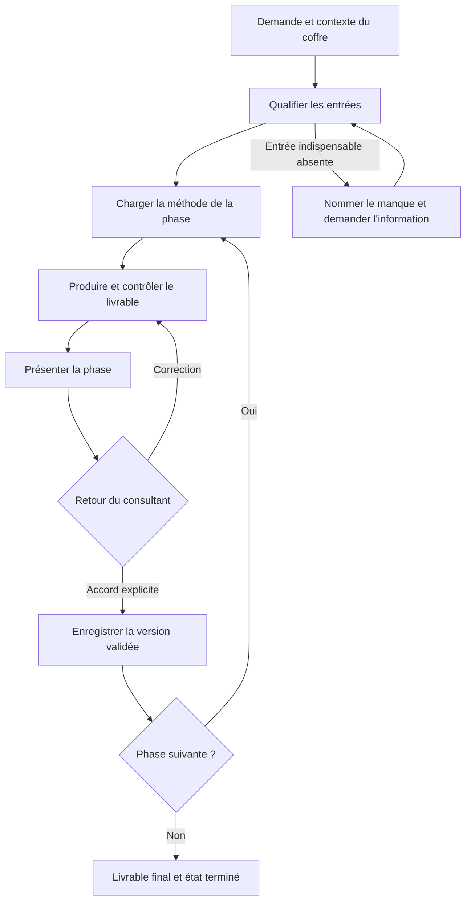

# Framework de création d'un agent spécialisé à étapes validées

Pour créer un agent, définir sa mission, ses déclencheurs, ses entrées, ses méthodes, ses livrables intermédiaires, leurs contrôles et les conditions de validation. Chaque exécution conserve les sources et l'état du travail dans le coffre de la conversation. Le framework reprend les contrats de `strategie-mot-cle`, de `seo-workflow-article` et la gouvernance de Tim. [[methodes/strategie-mot-cle-par-etapes]] [[moc/doctrine-seo-reference]]

Ce document est un modèle de conception réutilisable. Le contrôleur Python de l'agent stratégie reste une implémentation spécifique à ce métier. La rédaction dispose de ses quatre phases dans son skill ; le présent document ne lui attribue pas les contrôles techniques du premier agent.

## 1. Écrire le contrat métier

Compléter une phrase : « Pour [utilisateur], cet agent réalise [mission précise] à partir de [entrées] afin de fournir [livrable exploitable]. » Définir le résultat dont l'utilisateur a besoin et le critère qui permettra de le reconnaître.

Le contrat précise les formulations qui appellent l'agent, la priorité entre les agents susceptibles de répondre et le comportement face à une demande ambiguë. Un complément comme « juste pour X » reprend la mission seulement quand la conversation permet de la retrouver. Une demande explicite de changer de mission conduit à requalifier le besoin et les méthodes.

Le périmètre indique aussi les actions permises pendant le travail et les validations nécessaires. Un agent qui prépare un texte s'arrête au livrable validé ; sa publication est une action définie séparément. Le coffre courant reste le périmètre de données par défaut.

| Contrat | Agent stratégie mot-clé | Agent rédaction |
|---|---|---|
| Mission | Préparer la stratégie d'un seul mot-clé | Rédiger une page à partir d'un brief et d'une matière validés |
| Déclencheur | « Stratégie mot clé X », « quoi faire pour le mot clé X » | « Rédige un article », « applique le workflow rédaction » |
| Qualification | Offre, prospect, problème, action attendue, intérêt du mot-clé, URL existante | Requête, cible, objectif de la page, angle et destination validée |
| Résultat | Intentions, questions et matière disponible pour les traiter | Texte dont les affirmations proviennent de la matière validée |
| Autorité | Tim valide les pré-décisions | Le consultant valide les phases éditoriales |

## 2. Charger les méthodes et les sources

Réutiliser les skills disponibles avant de créer une procédure. Pour chacun, conserver son nom, son emplacement, sa version ou son empreinte et l'étape qui l'utilise. Le chargement lit le contenu réel de la méthode. L'agent consigne les outils qu'il a effectivement exécutés. Une méthode qui mentionne un outil absent doit signaler cette limite ; son texte seul ne prouve pas que l'outil a tourné.

Les entrées sont cherchées dans le coffre avant d'être demandées à l'utilisateur. Quand un élément indispensable reste absent, poser les questions qui changent la suite du travail. Le métier détermine l'ordre des sources : les appels et échanges commerciaux passent en premier pour les questions d'acheteurs ; un audit technique commence par les observations techniques disponibles.

Chaque pièce retenue doit soutenir une réponse ou une affirmation nommée. Vérifier son extrait, sa provenance, sa fiabilité, son actualité et son exploitabilité. Séparer faits observés, interprétations, hypothèses et informations manquantes. [[concepts/preuve-atomique]] [[methodes/questions-par-perspective]]

## 3. Définir les phases par leurs livrables

Chaque phase a une entrée suffisante, une méthode, un livrable, des critères de remise et une condition de validation. Une phase doit produire quelque chose que l'utilisateur peut examiner avant d'autoriser le travail dépendant.

| Élément | À écrire pour chaque phase |
|---|---|
| Entrées | Données nécessaires et livrables précédents validés |
| Méthode | Skill chargé et opérations utiles |
| Livrable | Fichier ou résultat précis montré à l'utilisateur |
| Contrôles | Conditions vérifiables avant remise |
| Jugement | Pertinence ou qualité à expliquer au consultant |
| Validation | Personne qui approuve ce livrable et accord enregistré |
| Correction | Éléments à reprendre et dépendances à réexaminer |
| Blocage | Donnée ou capacité absente et prochaine action utile |

Les deux agents illustrent deux découpages différents :

| Phase | Stratégie mot-clé | Rédaction |
|---|---|---|
| 1 | Qualification business et micro-intentions | Brief |
| 2 | Questions d'acheteurs, terrain d'abord | Structure H1/H2/H3 |
| 3 | Matière propriétaire pertinente et qualifiée | Chiffres, sources, verbatims et cas dans les Hn |
| 4 | — | Rédaction à partir de la phase 3 validée |

Les objectifs de quantité sont propres à la mission. Pour la stratégie, cinq intentions et quinze questions sont souples et les écarts justifiés. Pour la rédaction, la structure et la matière validées définissent ce qui peut entrer dans le texte. [[methodes/strategie-mot-cle-par-etapes]] [[concepts/workflow-redaction-8-etapes]]

## 4. Faire avancer l'état après validation



Dans ces deux workflows, une réponse livre une seule phase, puis attend l'accord du consultant. Une correction refait la phase concernée et requiert une nouvelle validation. Le silence et l'accord donné sur un autre livrable ne valident pas la version affichée.

Pour concevoir un nouvel agent, rattacher l'accord à la révision précise du livrable. Si une phase validée change ensuite, conserver son historique, indiquer quelles phases dépendantes doivent être revues et suspendre leur statut valide jusqu'à cette revue. Cette règle doit être implémentée et testée si l'agent permet de revenir sur une phase déjà approuvée ; elle ne peut pas être déduite d'une simple phrase dans le prompt.

## 5. Distinguer contrôle technique et jugement métier

| Contrôle | Vérification possible |
|---|---|
| Méthode chargée | Lecture du fichier et version conservée |
| Source accessible | Chemin dans le bon coffre et fichier présent |
| Extrait fidèle | Extrait retrouvé dans le document |
| Calcul exact | Note recalculée à partir des preuves admissibles |
| Phase autorisée | Prérequis et validation de la phase précédente enregistrés |
| Intention distincte | Besoin de décision explicité et comparaison sémantique |
| Preuve directement pertinente | Affirmation soutenue et justification du lien |
| Qualité éditoriale | Lecture du texte, utilité, exactitude et voix |

Le script peut exiger et vérifier les champs d'une évaluation. La présence de ces champs ne suffit pas à établir la justesse de l'évaluation. Le consultant doit voir les éléments qui permettent de la juger.

Un score se définit uniquement si la mission en bénéficie : objet mesuré, formule, critères d'admission des preuves et limites. Le score de matière de l'agent stratégie compte des catégories de preuves admissibles. Il ne mesure pas la valeur business d'un sujet et ne doit pas devenir un score universel pour tous les agents. [[methodes/rapport-mots-cles-format]]

## 6. Conserver un état utile à la reprise

Le fichier humain contient le contexte, la phase courante, les livrables, les sources, les limites et les validations. Si un contrôleur technique est utile, un état structuré conserve aussi l'identifiant d'exécution, le coffre, les versions des méthodes, les révisions des livrables, les approbations et les erreurs.

À la reprise d'une conversation, relire cet état et continuer depuis la dernière phase recevable. Ne pas reconstruire silencieusement une stratégie ou un plan déjà validé. Si une autre mission ou un autre coffre est demandé, rendre ce changement explicite avant d'utiliser leurs données.

Un agent d'appui reçoit une tâche délimitée, les pièces nécessaires et le livrable attendu. L'agent principal garde la mission d'origine et soumet les changements qui touchent une phase validée. La transmission entre stratégie et rédaction porte sur les intentions retenues, la matière, les limites et la destination décidée par le consultant. Elle ne vaut pas validation du brief ou des Hn.

## 7. Utiliser ce modèle de spécification

```yaml
agent_id: nom-de-l-agent
primary_mission: Résultat métier précis
owner: Consultant responsable de la validation
routing:
  triggers: [Formulation explicite, Variante de formulation]
  priority: Agent principal pour ce périmètre
  contextual_followups: Condition permettant de reprendre une demande abrégée
context:
  scope: Coffre de la conversation
  required_inputs: [Entrées indispensables]
  missing_input_behavior: Chercher dans les sources puis demander les manques
methods:
  - skill: Skill existant à réutiliser
    source: Chemin de la méthode
    version: Empreinte enregistrée au chargement
phases:
  - id: phase_1
    entry_conditions: Entrées suffisantes
    skill: Méthode de cette phase
    expected_output: Livrable examinable
    technical_checks: Conditions à vérifier par un contrôleur si nécessaire
    expert_review: Jugement à expliquer et à soumettre au consultant
    approval: Accord explicite sur cette révision
    on_correction: Reprendre la phase et ses dépendances touchées
evidence:
  source_order: Ordre adapté au métier
  eligibility: Pertinence directe, fiabilité, actualité et exploitabilité
  missing: Lacunes et collecte nécessaire
state:
  artifact: Fichier de travail dans le coffre
  approvals: Historique des accords et des révisions
completion: Conditions concrètes pour déclarer la mission terminée
```

Ce modèle est une spécification à adapter. Les champs ne constituent pas un moteur générique exécutable déjà installé.

## 8. Construire et vérifier un nouvel agent

1. Inspecter les méthodes, configurations et contrôleurs existants pour réutiliser ceux qui servent la mission.
2. Compléter le contrat et les phases avec leurs entrées, sorties et critères.
3. Créer le skill, ses déclencheurs précis et sa règle de priorité. Ajouter un contrôleur lorsque les transitions, calculs ou vérifications de sources doivent être reproductibles.
4. Vérifier le parcours normal et les échecs pertinents : méthode absente, entrée manquante, source hors coffre, extrait inventé, correction en cours et tentative de saut de phase. Tester la reprise et l'invalidation des dépendances si elles sont implémentées.
5. Montrer un premier livrable réel, attendre sa validation et continuer le parcours selon les phases prévues. Distinguer les tests techniques réussis de la qualité métier encore à valider.

## Prompt de construction réutilisable

> Construis dans le coffre courant un agent spécialisé pour [mission]. Reprends le framework de cette page et inspecte d'abord les skills, agents et contrôleurs existants. Définis son résultat métier, ses déclencheurs et leur priorité, les entrées indispensables et l'ordre des sources. Découpe son travail en phases qui produisent chacune un livrable examinable, avec méthode réellement chargée, contrôles de remise et validation explicite du consultant. Prévois la reprise, la correction d'une phase et la révision des travaux qui en dépendent. Conserve les sources et les versions validées. Adapte les nombres et les scores à la mission. Implémente les contrôles techniques nécessaires et teste les transitions et les erreurs pertinentes. Présente les fichiers construits, les vérifications exécutées et les limites restantes, puis commence uniquement la première phase si ses entrées sont disponibles.

Références : [[methodes/strategie-mot-cle-par-etapes]] · [[moc/doctrine-seo-reference]] · [[concepts/preuve-atomique]] · [[concepts/anti-ai-writing]].
